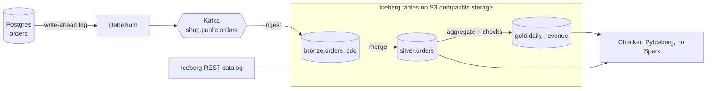

# Lakehouse reference implementation

The order-analytics lakehouse from the [ArchitectureCompass lakehouse page](https://architecturecompass.com/architectures/data/lakehouse/#reference-implementation), built in **[Java](https://dev.java/) and [Python](https://www.python.org/)**. Both versions follow the same [contract](CONTRACT.md), write the same [Apache Iceberg](https://iceberg.apache.org/) tables, and pass the same [demo](demo.sh).

Everything runs locally with open-source components: no cloud account needed.

## Why only Java and Python?

The processing engine here is [Apache Spark](https://spark.apache.org/), and Spark's [Structured Streaming](https://spark.apache.org/docs/latest/streaming/index.html) and Iceberg integration are first-class only from the JVM (Java, Scala) and Python. Other languages either have no Spark binding or only a partial one (for example Spark Connect clients without `foreachBatch`). In a real lakehouse the *pipelines* are written in these languages, while *consumers* can use anything that reads Iceberg. The [checker](check/check.py) shows that: it reads the tables with [PyIceberg](https://py.iceberg.apache.org/) and no Spark at all, and [Trino](https://trino.io/), DuckDB, Snowflake or [BigQuery](https://cloud.google.com/bigquery) could read them the same way.

## What it demonstrates

| Pattern | Where you see it |
|---|---|
| **Change data capture** | [Debezium](https://debezium.io/) reads the [Postgres](https://www.postgresql.org/) write-ahead log and streams every insert, update and delete to [Kafka](https://kafka.apache.org/) |
| **Bronze / silver / gold** | Raw change events → one current row per order → daily revenue for dashboards |
| **Incremental processing** | Streaming queries with an *available now* trigger and checkpoints: each run handles only what's new |
| **Idempotent merges** | `MERGE` keeps the latest change per order and never lets an older event overwrite a newer row |
| **Data-quality gate** | Gold is checked before it is published; a failed check publishes nothing |
| **Time travel** | Every commit is a snapshot; older versions of a table stay readable |
| **Table maintenance** | Compaction, snapshot expiry and orphan-file cleanup |
| **Open table format** | Spark writes, PyIceberg reads, through a standard Iceberg REST catalog |
| **Personal data stays out** | Customer emails remain in the restricted bronze `raw` column, never in silver or gold |



## Run it

You need [Docker](https://www.docker.com/) with Compose and about 4 GB of free memory.

```bash
./demo.sh python      # or: ./demo.sh java
```

The demo starts from a clean slate each time and takes two to three minutes. Expected output:

```text
1. Debezium snapshots the 8 existing orders into Kafka; the pipeline loads them
  PASS  bronze has 8 change events
  PASS  silver matches the source database
  PASS  gold revenue matches the source database
2. Change the source: pay one order, delete one, add one
  PASS  bronze keeps all 11 events (full history)
  PASS  silver applied the update, delete and insert
  PASS  gold revenue updated
3. Run again with nothing new: checkpoints prevent reprocessing
  PASS  no duplicate events, no new silver version
4. Time travel: read silver as it was after the first run
  PASS  old version still readable (o-1006 was PENDING)
5. Table maintenance: compaction, snapshot expiry, orphan-file cleanup
  PASS  tables still match the source after maintenance

Result: 9 passed, 0 failed
```

Try it by hand:

```bash
docker compose up -d
docker compose run --rm pipeline-python                 # one pipeline run (or pipeline-java)

# Change the source database, then run the pipeline again
docker compose exec postgres psql -U postgres -d shop \
  -c "UPDATE orders SET status = 'SHIPPED' WHERE order_id = 'o-1004'"
docker compose run --rm pipeline-python

# Query the lake with Spark SQL
docker compose run --rm --entrypoint /opt/spark/bin/spark-sql pipeline-python \
  -e "SELECT * FROM gold.daily_revenue ORDER BY revenue_date"

# Compare the lake with the source, without Spark
docker compose run --rm check state
```

Reset everything with `docker compose --profile '*' down -v`.

## Break it yourself

Run the demo once, then try these with `docker compose up -d` running.

**1. Stop change data capture for a while.** Changes made while Debezium is down are not lost: Postgres keeps them in its write-ahead log until Debezium catches up.

```bash
docker compose stop debezium
docker compose exec postgres psql -U postgres -d shop -c "UPDATE orders SET status = 'SHIPPED' WHERE order_id = 'o-1004'"
docker compose start debezium
docker compose run --rm pipeline-python          # bronze gains the event; silver shows SHIPPED
docker compose run --rm check state
```

**2. Trip the data-quality gate.** Insert an order with a negative amount in a new currency, then run the pipeline. Silver accepts the change, but gold refuses to publish (`gold: 1 rows failed data-quality checks; nothing published`) and the run exits with an error. Delete the bad order and run again to recover.

```bash
docker compose exec postgres psql -U postgres -d shop -c \
  "INSERT INTO orders VALUES ('o-2001', 'c-9', 'test@example.com', 'PAID', -50.00, 'GBP', now())"
docker compose run --rm pipeline-python          # fails at the gold step
docker compose exec postgres psql -U postgres -d shop -c "DELETE FROM orders WHERE order_id = 'o-2001'"
docker compose run --rm pipeline-python          # publishes again
```

**3. Travel back in time.** Every commit is a snapshot you can still query.

```bash
SQL="docker compose run --rm --entrypoint /opt/spark/bin/spark-sql pipeline-python -e"
$SQL "SELECT snapshot_id, committed_at, operation FROM silver.orders.snapshots ORDER BY committed_at"
$SQL "SELECT order_id, status FROM silver.orders VERSION AS OF <snapshot_id> WHERE order_id = 'o-1004'"
```

**4. Run the pipeline twice in a row.** The second run finds nothing new: bronze gains no rows and silver gets no new snapshot, because each streaming step records its progress in a checkpoint.

## The two implementations

| Language | Stack | Code |
|---|---|---|
| **Python** | [PySpark](https://spark.apache.org/docs/latest/api/python/) 4.1, Structured Streaming, Iceberg 1.12 | [`python/pipeline.py`](python/pipeline.py) |
| **Java 17** | Spark 4.1 Java API, Structured Streaming, Iceberg 1.12 | [`java/…/Pipeline.java`](java/src/main/java/com/architecturecompass/lakehouse/Pipeline.java) |

Shared by both:

| Component | Used here | Role |
|---|---|---|
| Source database | PostgreSQL 16 with `wal_level=logical` | The application's orders table |
| Change data capture | [Debezium Server](https://debezium.io/documentation/reference/stable/operations/debezium-server.html) 3.7 | Streams row changes to Kafka |
| Event stream | Apache Kafka 3.9 (KRaft) | Buffers change events |
| Object storage | [SeaweedFS](https://github.com/seaweedfs/seaweedfs) 4.53 (S3 API) | Holds table data and metadata files |
| Table catalog | Apache Iceberg REST catalog | Tracks tables, schemas and snapshots |
| Processing | Apache Spark 4.1, local mode | Ingest, merge, aggregate, maintain |
| Checker | PyIceberg | Reads the tables independently and compares with Postgres |

Where to look in each one:

- **Parsing CDC events:** `ingest` extracts fields from the Debezium envelope with `get_json_object`, taking the key from `before` for deletes.
- **The merge:** `MERGE_SQL`, run inside `foreachBatch` for each micro-batch of new bronze rows.
- **Publishing gold:** `writeTo(...).overwrite(revenue_date >= start)` replaces exactly the recomputed range, after the quality checks.
- **Maintenance:** Iceberg's `CALL lake.system.*` procedures.

## Production notes

These samples run everything on one machine. In production you would also want:

- **Continuous or scheduled runs.** Here you run the pipeline by hand. In production an orchestrator such as [Airflow](https://airflow.apache.org/) or [Dagster](https://dagster.io/) runs it every few minutes, or the streaming steps run continuously with a processing-time trigger.
- **Checkpoints on durable storage.** They live in a Docker volume here; put them in object storage next to the tables.
- **A production catalog** such as [Apache Polaris](https://polaris.apache.org/), [Nessie](https://projectnessie.org/), [AWS Glue](https://aws.amazon.com/glue/) or [Unity Catalog](https://www.databricks.com/product/unity-catalog), with access policies per table and column. The REST catalog used here is Iceberg's test server.
- **A SQL engine for analysts** such as Trino, reading the same tables.
- **Schema-change handling.** Debezium emits new columns automatically; detect them and evolve the Iceberg tables deliberately rather than dropping data silently.
- **Reconciliation and freshness alerts.** Compare daily counts and totals with the source system, and alert when gold falls behind.
- **Ordering by log position.** The merge orders changes by commit time and Kafka offset. With several partitions or sources, use the source's log sequence number (`source.lsn`) instead.
- **Real maintenance schedules.** Run compaction and cleanup nightly per table, with retention set by how far back you need time travel.

## Files

```text
lakehouse/
├── CONTRACT.md              Commands, tables and rules shared by both languages
├── docker-compose.yml       Postgres, Kafka, Debezium, SeaweedFS, Iceberg catalog, pipelines, checker
├── demo.sh                  End-to-end check: CDC, merges, replays, time travel, maintenance
├── infra/
│   ├── postgres/init.sql    Orders table with eight sample orders
│   ├── debezium/            Debezium Server configuration
│   └── spark/               Catalog, storage and logging settings shared by both pipelines
├── check/                   Independent checker (PyIceberg + psycopg)
├── python/                  PySpark pipeline
└── java/                    Spark Java pipeline
```
