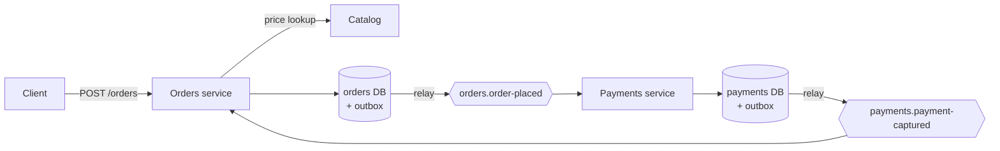

# Microservices reference implementation

The ordering platform from the [ArchitectureCompass microservices page](https://architecturecompass.com/architectures/software-styles/microservices/#reference-implementation), built six times: in **[Java](https://dev.java/), [Python](https://www.python.org/), [Go](https://go.dev/), [Rust](https://www.rust-lang.org/), [C#](https://learn.microsoft.com/dotnet/csharp/) and [TypeScript](https://www.typescriptlang.org/)**. Every version implements the same [contract](CONTRACT.md) and passes the same [demo](demo.sh), so you can compare languages line by line.

## What it demonstrates

| Pattern | Where you see it |
|---|---|
| **Transactional outbox** | The order and its `OrderPlaced` event are written in one database transaction; a relay publishes them to [Kafka](https://kafka.apache.org/) |
| **Idempotent consumers** | Every event ID is recorded with the change it caused; redelivered events are ignored |
| **At-most-once payment** | A unique constraint guarantees one payment per order, even if events are duplicated |
| **Idempotent API** | Repeating `POST /orders` with the same `Idempotency-Key` returns the original order |
| **Resilience** | Catalog calls have a 500 ms timeout, retries and a circuit breaker, falling back to the last known price |
| **Database per service** | Orders and Payments each own a database and never read each other's tables |



## Run it

You need [Docker](https://www.docker.com/) with Compose. Pick a language profile:

```bash
docker compose --profile java up -d --build     # or: python, go, rust, dotnet, node
./demo.sh
```

Expected output:

```text
1. Place an order
  PASS  202 Accepted, order 7e7e930a-…
  PASS  amount 59.98 (2 x 29.99 from the catalog)
2. Repeat the request with the same Idempotency-Key
  PASS  same order returned, nothing duplicated
3. Outbox -> Kafka -> Payments -> Kafka -> Orders
  PASS  order CONFIRMED after payment captured
4. Redeliver the same OrderPlaced event (simulating an at-least-once duplicate)
  PASS  still exactly 1 payment for the order
5. Stop the catalog: cached prices keep orders flowing
  PASS  SKU-1 accepted at last known price 29.99
  PASS  SKU-3 (never priced) rejected with 503

Result: 7 passed, 0 failed
```

**Switching languages:** reset everything first with `docker compose --profile <old> down -v`. Kafka remembers consumer groups for a while, and some clients refuse to join a group that another client library created moments earlier.

Try it by hand:

```bash
curl -X POST localhost:8081/orders -H 'Content-Type: application/json' \
     -H 'Idempotency-Key: my-first-order' -d '{"customerId":"c-1","sku":"SKU-2","quantity":1}'
curl localhost:8081/orders/<orderId>
```

## The six implementations

| Language | Stack | Orders | Payments |
|---|---|---|---|
| **Java 21** | [Spring Boot](https://spring.io/projects/spring-boot) 4, JdbcTemplate, [Spring Kafka](https://spring.io/projects/spring-kafka), [Resilience4j](https://resilience4j.readme.io/) | [`java/orders`](java/orders/src/main/java/com/architecturecompass/orders) | [`java/payments`](java/payments/src/main/java/com/architecturecompass/payments) |
| **Python 3.12** | [FastAPI](https://fastapi.tiangolo.com/), [psycopg 3](https://www.psycopg.org/psycopg3/), [confluent-kafka](https://github.com/confluentinc/confluent-kafka-python), [pybreaker](https://github.com/danielfm/pybreaker) | [`python/orders/app.py`](python/orders/app.py) | [`python/payments/app.py`](python/payments/app.py) |
| **Go 1.25** | net/http, [pgx](https://github.com/jackc/pgx), [kafka-go](https://github.com/segmentio/kafka-go), [gobreaker](https://github.com/sony/gobreaker) | [`go/orders/main.go`](go/orders/main.go) | [`go/payments/main.go`](go/payments/main.go) |
| **Rust** | [axum](https://github.com/tokio-rs/axum), [sqlx](https://github.com/launchbadge/sqlx), [rdkafka](https://github.com/fede1024/rust-rdkafka), [reqwest](https://github.com/seanmonstar/reqwest) | [`rust/orders/src`](rust/orders/src) | [`rust/payments/src`](rust/payments/src) |
| **C# ([.NET](https://dotnet.microsoft.com/) 10)** | [ASP.NET Core](https://dotnet.microsoft.com/apps/aspnet) minimal APIs, [Npgsql](https://www.npgsql.org/), [Confluent.Kafka](https://github.com/confluentinc/confluent-kafka-dotnet), [Polly](https://www.pollydocs.org/) | [`dotnet/Orders`](dotnet/Orders) | [`dotnet/Payments`](dotnet/Payments) |
| **TypeScript ([Node](https://nodejs.org/) 22)** | [Fastify](https://fastify.dev/), [node-postgres](https://node-postgres.com/), [KafkaJS](https://kafka.js.org/) | [`node/orders/src`](node/orders/src) | [`node/payments/src`](node/payments/src) |

Where to look in each one:

- **Outbox write:** the place-order handler inserts into `orders` and `outbox` inside one transaction.
- **Outbox relay:** a background loop selects unpublished rows `FOR UPDATE SKIP LOCKED`, sends them to Kafka, and marks them published in the same transaction.
- **Idempotent consumer:** `INSERT INTO processed_events … ON CONFLICT DO NOTHING`. If no row was inserted, the event was already handled.
- **Circuit breaker:** Java, Python, Go and C# use their ecosystem's standard library (Resilience4j, pybreaker, gobreaker, Polly). Rust and TypeScript include a 30-line breaker so you can see exactly how one works.

## Production notes

These samples keep infrastructure minimal so they run on a laptop. In production you would also want:

- **Change data capture instead of polling.** A tool such as [Debezium](https://debezium.io/) reads the outbox from the database log, with lower latency and no polling load. The polling relay here is simpler to run and still correct.
- **A real payment provider**, called with the order ID as its idempotency key so a retried call can never charge twice.
- **Dead-letter topics** for events that keep failing, instead of retrying forever.
- **Schema registry and versioning** for event contracts.
- **Distributed tracing** with [OpenTelemetry](https://opentelemetry.io/) across HTTP calls and Kafka messages.
- **One language per topic producer.** The Kafka clients use different default partitioners, so mixing languages that publish to the same topic can split one order's events across partitions.

## Files

```text
microservices/
├── CONTRACT.md            API, events and required behavior shared by all languages
├── docker-compose.yml     Postgres, Kafka, catalog stub, and a profile per language
├── demo.sh                Checks all five required behaviors
├── infra/
│   ├── postgres/init.sql  Shared schema (orders and payments databases)
│   └── catalog/           Price lookup stub (nginx)
└── java/ python/ go/ rust/ dotnet/ node/
```
