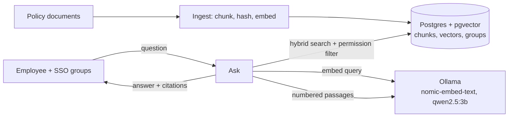

# RAG reference implementation

The policy assistant from the [ArchitectureCompass RAG page](https://architecturecompass.com/architectures/ai-ml/rag/#reference-implementation), built six times: in **[Java](https://dev.java/), [Python](https://www.python.org/), [Go](https://go.dev/), [Rust](https://www.rust-lang.org/), [C#](https://learn.microsoft.com/dotnet/csharp/) and [TypeScript](https://www.typescriptlang.org/)**. Every version implements the same [contract](CONTRACT.md), uses the same [retrieval query](retrieval.sql) and prompt, and passes the same [demo](demo.sh).

Everything runs locally. The models are served by [Ollama](https://ollama.com/), so you need no API key and no document leaves your machine.

## What it demonstrates

| Pattern | Where you see it |
|---|---|
| **Section-aware chunking** | Each `##` section becomes a chunk, prefixed with the document title and section name so it makes sense on its own |
| **Incremental ingestion** | A hash of model + permissions + content decides what to re-embed; re-running ingestion on unchanged documents embeds nothing |
| **Hybrid search** | Vector similarity ([pgvector](https://github.com/pgvector/pgvector), HNSW) and [Postgres](https://www.postgresql.org/) full-text search, merged with reciprocal rank fusion |
| **Permission-aware retrieval** | Chunks carry `allowed_groups`; the filter is applied *inside* the query, so the model never sees what the user can't |
| **Grounded answers with citations** | The model may only use numbered passages and must cite them as `[n]`; citations are mapped back to document and section |
| **Refusal** | Below a similarity threshold the service refuses without calling the model; the model can also answer `NOT_FOUND` |



## Run it

You need [Docker](https://www.docker.com/) with Compose and about 4 GB of free memory. Pick a language profile:

```bash
docker compose --profile python up -d --build    # or: java, go, rust, dotnet, node
./demo.sh
```

The first start downloads about 2.2 GB of models into a named Docker volume; later starts reuse them. On a laptop CPU an answer takes roughly 5 to 15 seconds.

Expected output:

```text
1. Ingest the policy documents
  PASS  5 documents chunked
2. Ingest again: nothing changed, nothing re-embedded
  PASS  0 chunks re-embedded
3. Answer with a citation
  PASS  found, cites parental-leave
  PASS  answer mentions 16 weeks
4. Permissions: staff cannot retrieve manager-only documents
  PASS  manager-only document not cited for staff
5. The same question from a manager
  PASS  manager sees manager-compensation-guidelines
6. Refuse questions the documents can't answer
  PASS  not found, no made-up answer

Result: 7 passed, 0 failed
```

**Switching languages:** stop the old profile and reset the database, but keep the model volume:

```bash
docker compose --profile python down
docker compose rm -sfv postgres
docker compose --profile go up -d --build
```

(`down -v` also works, but deletes the downloaded models.)

Try it by hand:

```bash
curl -X POST localhost:8090/ask -H 'Content-Type: application/json' \
     -d '{"question":"Can I work from another country?","groups":["all-staff"]}'
```

```json
{"found":true,"answer":"Employees may work from another country for up to two weeks per calendar year [1].",
 "citations":[{"documentId":"remote-work","title":"Remote Work Policy","section":"Working from abroad"}]}
```

Add or edit a file in [`docs/`](docs/) and call `POST /ingest` again: only the changed sections are re-embedded.

## The six implementations

| Language | Stack | Code |
|---|---|---|
| **Java 21** | [Spring Boot](https://spring.io/projects/spring-boot) 4, JdbcTemplate, RestClient | [`java/src/main/java/…/rag`](java/src/main/java/com/architecturecompass/rag) |
| **Python 3.12** | [FastAPI](https://fastapi.tiangolo.com/), [psycopg 3](https://www.psycopg.org/psycopg3/), [httpx](https://www.python-httpx.org/) | [`python/app.py`](python/app.py) |
| **Go 1.25** | net/http, [pgx](https://github.com/jackc/pgx) | [`go/main.go`](go/main.go) |
| **Rust** | [axum](https://github.com/tokio-rs/axum), [sqlx](https://github.com/launchbadge/sqlx), [reqwest](https://github.com/seanmonstar/reqwest) | [`rust/src/main.rs`](rust/src/main.rs) |
| **C# ([.NET](https://dotnet.microsoft.com/) 10)** | [ASP.NET Core](https://dotnet.microsoft.com/apps/aspnet) minimal APIs, [Npgsql](https://www.npgsql.org/), HttpClient | [`dotnet`](dotnet) |
| **TypeScript ([Node](https://nodejs.org/) 22)** | [Fastify](https://fastify.dev/), [node-postgres](https://node-postgres.com/), fetch | [`node/src/main.ts`](node/src/main.ts) |

None of them uses an LLM framework. Each talks to Ollama's HTTP API and to Postgres directly, so every step of the pipeline is visible in a few hundred lines.

Where to look in each one:

- **Chunking:** split on `^## `, then split long sections on paragraph boundaries above 1,500 characters.
- **Change detection:** `sha256(model | groups | content)` compared with the stored hash; only changed chunks are embedded, in one batch.
- **Retrieval:** the SQL in [`retrieval.sql`](retrieval.sql), copied verbatim into each language. Note the `allowed_groups && $3` filter in *both* the vector and keyword branches.
- **Refusal:** if the best similarity is below `MIN_SIMILARITY` (0.55), return "not found" before calling the model.
- **Citations:** parse `[n]` from the answer, map each to its passage, and de-duplicate by document and section.

## Production notes

These samples keep the moving parts minimal. In production you would also want:

- **An evaluation set.** A few hundred real questions with expected sources, run on every change to chunking, models or prompts. Without it you can't tell whether a change helped.
- **A re-ranker** (a cross-encoder) over the top 20–40 hybrid results before choosing the passages for the prompt.
- **Permission sync** from your identity provider and document systems, so `allowed_groups` stays current when access changes, not only when content does.
- **Prompt-injection defenses.** Treat document text as data: strip instructions from retrieved content, restrict what the model can do, and never give it tools that act on the user's behalf based on retrieved text alone.
- **A larger model.** `qwen2.5:3b` keeps the demo laptop-sized; a hosted or larger local model gives noticeably better answers. Change `CHAT_MODEL` in `docker-compose.yml`.
- **Re-embedding on model change.** The model name is part of the hash, so switching `EMBED_MODEL` re-embeds everything on the next ingest. Plan for that cost.
- **Logging and feedback.** Store questions, retrieved chunk IDs, answers and user ratings to find gaps in the documents.

## Files

```text
rag/
├── CONTRACT.md            API, chunking, retrieval and answer rules shared by all languages
├── retrieval.sql          The hybrid, permission-filtered query every language runs
├── docker-compose.yml     Postgres + pgvector, Ollama, model download, and a profile per language
├── demo.sh                Checks ingestion, citations, permissions and refusal
├── docs/                  Five sample policy documents (one is managers-only)
├── infra/init.sql         Schema: chunks, vectors, full-text and HNSW indexes
└── java/ python/ go/ rust/ dotnet/ node/
```
